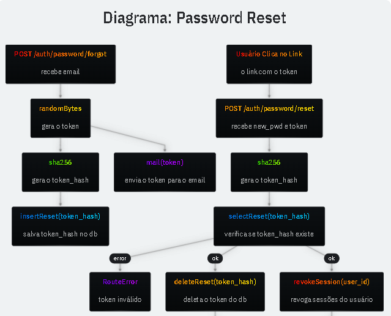
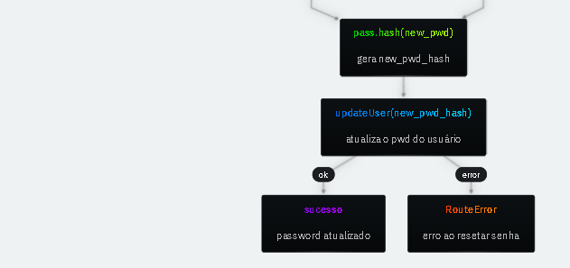

# Diagrama:




# Resets Table

A tabela com os tokens para reset do password possui a mesma lógica da tabela de sessões.

```SQL
CREATE TABLE IF NOT EXISTS "resets" (
  "token_hash" BLOB PRIMARY KEY,
  "user_id" INTEGER NOT NULL,
  "created" INTEGER NOT NULL DEFAULT (STRFTIME('%s', 'NOW')),
  "expires" INTEGER NOT NULL,
  "ip" TEXT,
  "ua" TEXT,
  FOREIGN KEY ("user_id") REFERENCES "users" ("id") ON DELETE CASCADE
) WITHOUT ROWID, STRICT;

CREATE INDEX IF NOT EXISTS "idx_resets_user" ON "resets" ("user_id");

```
