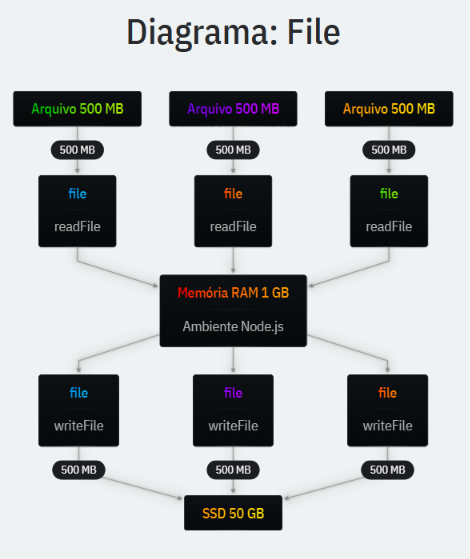

# Memória

Qualquer dado que colocamos na nossa aplicação é alocado na memória RAM disponível no ambiente em que a mesma está sendo executada. Essa memória é gerenciada pelo sistema operacional e pelo **GC (garbage collector) do V8**.

## Espaço Físico

Cada caractere ocupa um certo espaço físico na memória RAM.

- No frontend isso não impacta muito, pois esse espaço é o do computador do cliente.
- Já no servidor, há limite:

## Limite

O limite é definido pelo sistema, um limite comum em VPS de entrada é de 1 GB.

```js
//exemplo de inflagem de memória (ver o resultado no monitoramento de memória)

const acc = [];
setInterval(() => {
  acc.push(new Array(2_000_000).fill("a"));
}, 300);
```

# Arquivos

Quando lemos um arquivo com a função `readFile` ou recebemos ele através de uma **requisição ao servidor**, colocamos o mesmo temporariamente na memória.

- **readFile**  
  O `readFile` coloca o arquivo inteiro temporariamente na memória. Isso pode ser um problema no caso de arquivos grandes.

- **bodyParser**  
  O corpo recebido também fica na memória, um corpo grande vindo de muitas conexões por segundo pode ultrapassar o limite de memória.

```js
//exemplo de inflagem de memória
const files = [];

for (let i = 0; i < 10; i++) {
  files.push(await readFile("./entrada.txt"));
}
```

# Diagrama de exemplo:  
