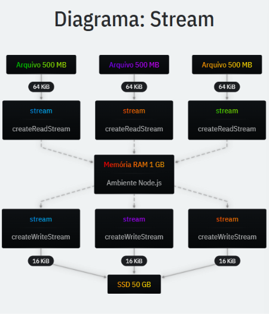

# Stream

Streams permitem enviar/receber dados em pequenos chunks. O tamanho do chunk é definido pelo `highWaterMark`, sendo cerca de 64/16 KiB o padrão.

- **createReadStream**  
  Cria uma stream de leitura, usada para a leitura de dados.

- **createWriteStream**  
  Cria uma stream de escrita, usada para a escrita de dados.

- **pipeline**  
  Conecta uma ReadStream com uma WriteStream. Evita o armazenamento temporário do dado completo na memória RAM.

```js
import { createReadStream, createWriteStream } from "node:fs";
import { readFile, writeFile } from "node:fs/promises";
import { pipeline } from "node:stream/promises";

for (let i = 0; i < 20; i++) {
  // receiveFile(i); // trava
  // receiveFileStream(i); // não trava
}

async function receiveFile(i) {
  const body = await readFile("./entrada.txt");
  await writeFile(`./saida-${i}.txt`, body);
}

async function receiveFileStream(i) {
  const read = createReadStream("./entrada.txt");
  const write = createWriteStream(`./saida-${i}.txt`);
  await pipeline(read, write);
}
```

## createReadStream

Cria uma `Readable stream`. `IncomingMessage` (`request`) é uma `Readable stream`.

- **on**  
  Escuta eventos que ocorrem na stream. `data` ocorre a cada pedaço enviado e `end` quando termina.

- **toArray**  
  Consome todo o conteúdo da stream e coloca em um `buffer`.

- **for await (const chunk of req)**  
  Podemos também consumir a stream com o `for await`, como já fizemos no `body-parser`.

```ts
import { createReadStream } from "node:fs";

// toArray
async function readStream_toArray() {
  const file = createReadStream("./dados.json");
  const data = (await file.toArray()).toString();
  const body = JSON.parse(data);
  console.log(body);
}
readStream_toArray();

// for await
async function readStream_forAwait() {
  const file = createReadStream("./dados.json");
  const chunks = [];
  for await (const chunk of file) {
    chunks.push(chunk);
  }
  const data = Buffer.concat(chunks).toString();
  const body = JSON.parse(data);
  console.log(body);
}
readStream_forAwait();

// on data/end
function readStream_onData() {
  const file = createReadStream("./dados.json");
  const chunks: any[] = [];
  file
    .on("data", (chunk) => {
      chunks.push(chunk);
    })
    .on("end", () => {
      const data = Buffer.concat(chunks).toString();
      const body = JSON.parse(data);
      console.log(body);
    });
}
readStream_onData();
```

```ts
import { createServer } from "node:http";

// req é uma Readable stream
createServer(async (req, res) => {
  const data = (await req.toArray()).toString();
  const body = JSON.parse(data);
  console.log(body);
  res.end();
}).listen(3000);
```

# createWriteStream

Cria uma `Writable stream`. `ServerResponse` é um tipo de `Writable stream`.

- **write**  
  Escreve/envia o chunk para o destino.

- **end**  
  Finaliza a stream e envia um chunk final.

- **flags**  
  Opções da stream: a - append (adiciona ao arquivo, cria se não existir), w - write (escreve por cima, cria se não existir), r - read, x - (ax, wx - apenas se não existir).

```ts
//exemplo: criando arquivo de log
const log = createWriteStream("./log.txt", { flags: "a" });

const server = createServer(async (req, res) => {
  log.write(`${req.method} ${req.socket.remoteAddress} ${req.url} \n`);
  res.end();
});

server.listen(3000).on("close", () => {
  log.end();
});
```

# Pipeline

Função do node que permite conectarmos uma Readable stream com uma Writable stream.

- **Error Handling**  
  Pipeline emite um erro caso exista um problema na stream, esse erro pode ser pego em um bloco de try/catch.

- **Backpressure**  
  Quando a leitura ocorre mais rápida do que a escrita o pipeline pausa a leitura enquanto a escrita é feita.

- **Pipe vs Pipeline?**  
  Prefira o **Pipeline**, ele foi criado para resolver problemas do pipe como o error handling.

```ts
import { createReadStream, createWriteStream } from "node:fs";
import { pipeline } from "node:stream/promises";

const read = createReadStream("./entrada.txt");
const write = createWriteStream("./saida.txt");

try {
  await pipeline(read, write);
} catch (error) {
  console.error(error);
}
```

```ts
import { createReadStream } from "node:fs";
import { createServer } from "node:http";
import { pipeline } from "node:stream/promises";

createServer(async (req, res) => {
  try {
    const read = createReadStream("./dados.json");
    await pipeline(read, res);
  } catch (error) {
    res.statusCode = 500;
    res.end("error");
  }
}).listen(3000);
```
